<div align="center">

# Surv-AI

### Your everyday, worth remembering.

A locally hosted AI-assisted personal activity observation, analytics and recall platform.

**Windows · Node.js · OpenCV · SQLite · Optional OpenAI analysis**

[Walkthrough](#a-day-with-surv-ai) · [Install](#install-on-windows) · [Architecture](#how-it-works) · [Privacy](#privacy-and-security) · [Release verification](docs/RELEASE-VERIFICATION.md)

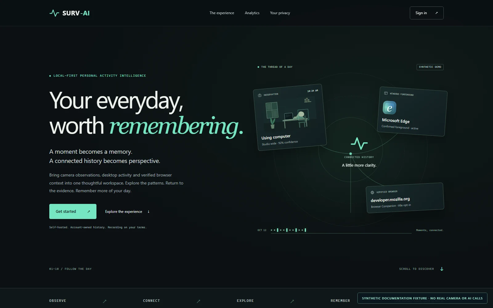

</div>

Surv-AI helps answer a familiar question: **what did I actually do today?** It turns selected camera snapshots into saved, searchable moments, with optional Windows application and paired browser context. History, local questions, analytics and PDF summaries make those moments easier to revisit.

It is built around personal awareness and explicit controls. The record consists of **point-in-time observations**, not continuous video, a complete account of someone's day, measured attention or a medical assessment. Camera evidence and foreground context can complement each other, but neither establishes intent or continuous activity.

**Local-first does not mean fully offline:** selected images and, when enabled, associated desktop/browser metadata may be sent to the configured OpenAI API. Accounts, history and configuration are stored locally. Browsing the app, local Ask, charts and reports do not require new AI requests.

## A day with Surv-AI

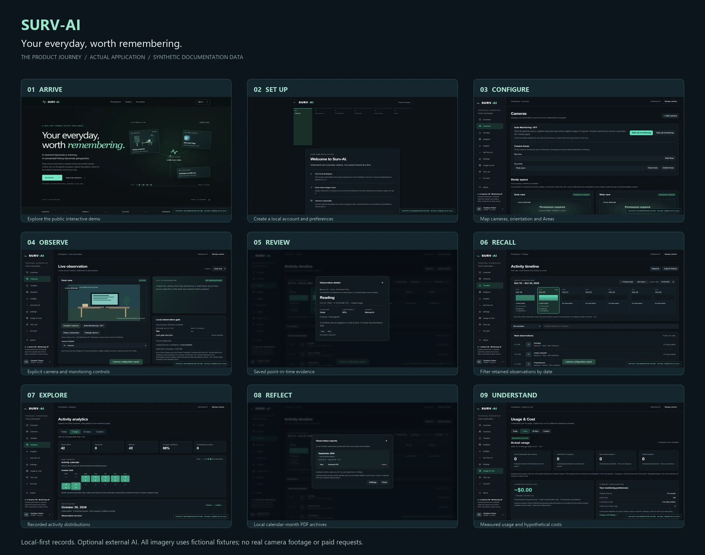

Every image below is captured from the real application in an isolated installation. All people, accounts, observations and context shown are **synthetic documentation fixtures**. The live preview is a generated canvas, not webcam footage. No paid AI requests or real desktop/browser collection were used. See [screenshot provenance](docs/screenshots/README.md).

| Step | What happens |
| --- | --- |
| **1 · Arrive** | Explore Homepage V2's labeled interactive demonstrations without logging in, opening a camera or calling AI. |
| **2 · Make it yours** | Create the first local ADMIN account, optionally configure your own API key, and choose preferences. |
| **3 · Configure cameras** | Name local cameras, confirm devices, set orientation, group shared views into Areas and save rotation order. |
| **4 · Observe deliberately** | Explicitly enable a camera and Auto Monitoring. Local person checks and the existing scheduler decide whether a frame is eligible. |
| **5 · Review the evidence** | Open a recorded observation, its source and optional context. Search Timeline by date, label and camera. |
| **6 · Reflect** | Explore recorded distributions, local Ask answers, usage estimates and retained-history PDF reports. |

### Setup and camera control

| First-run setup | Cameras and Areas |
| --- | --- |
| 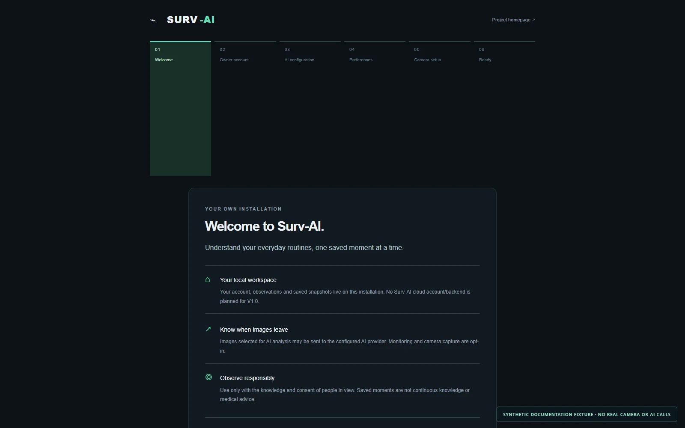 | 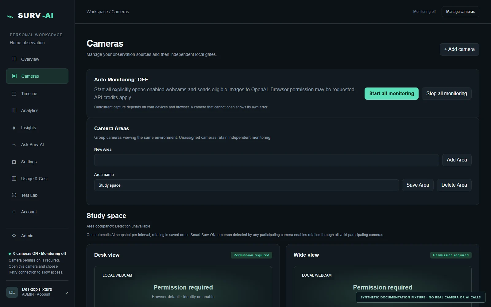 |

### Capture and recall

| Live Observation | Main dashboard |
| --- | --- |
| 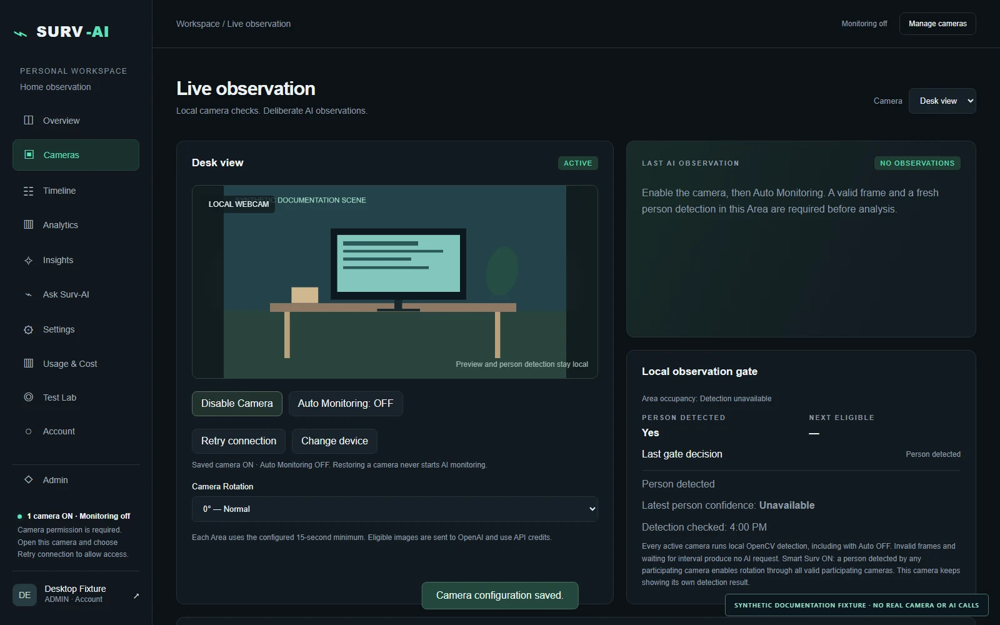 | 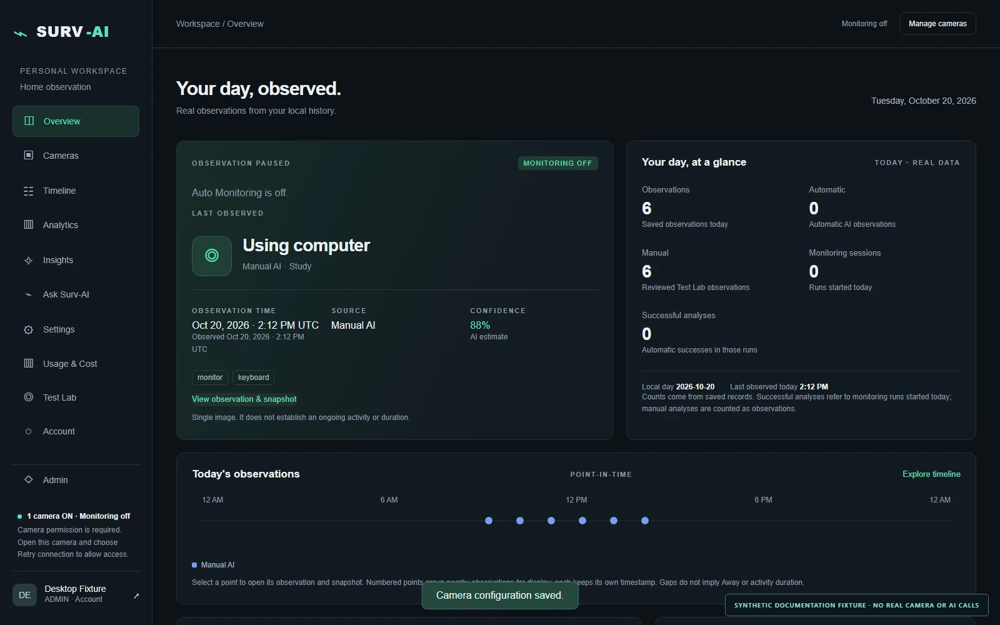 |
| **Activity history** | **Observation evidence** |
| 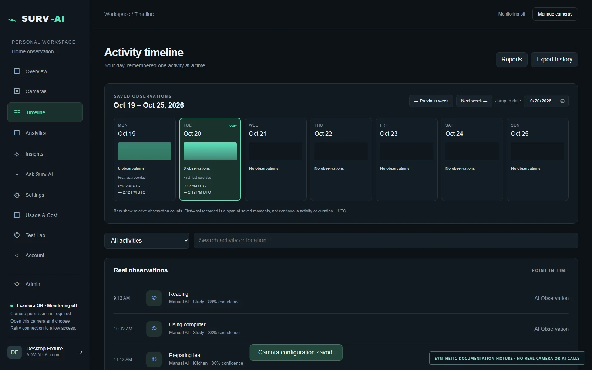 | 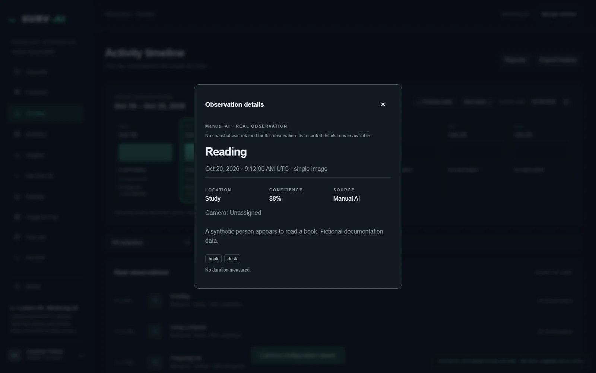 |

### Explore and understand

| Analytics Explorer | Ask Surv-AI |
| --- | --- |
| 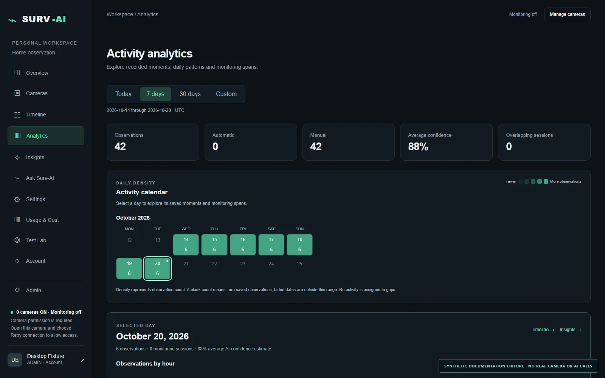 | 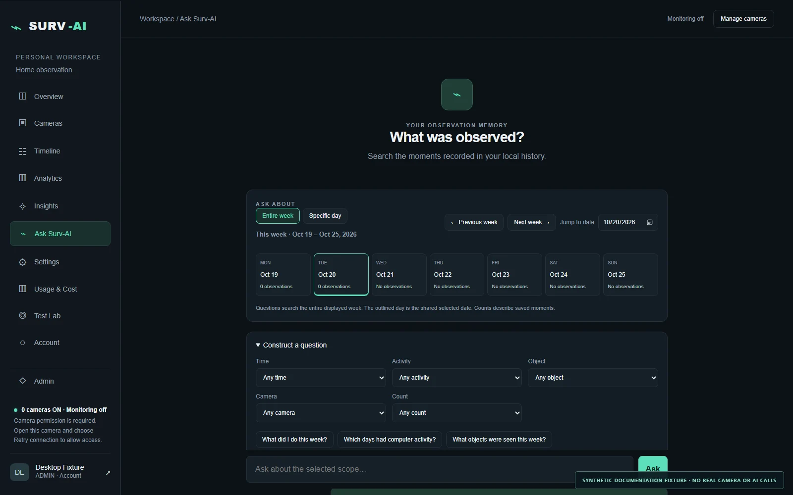 |
| **Desktop Context** | **Browser Context** |
| 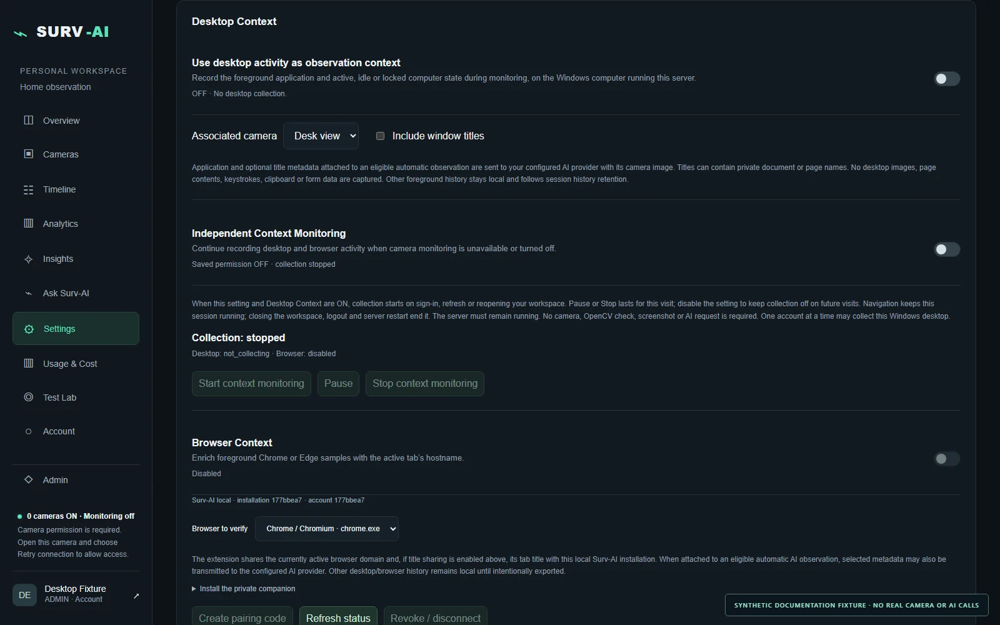 | 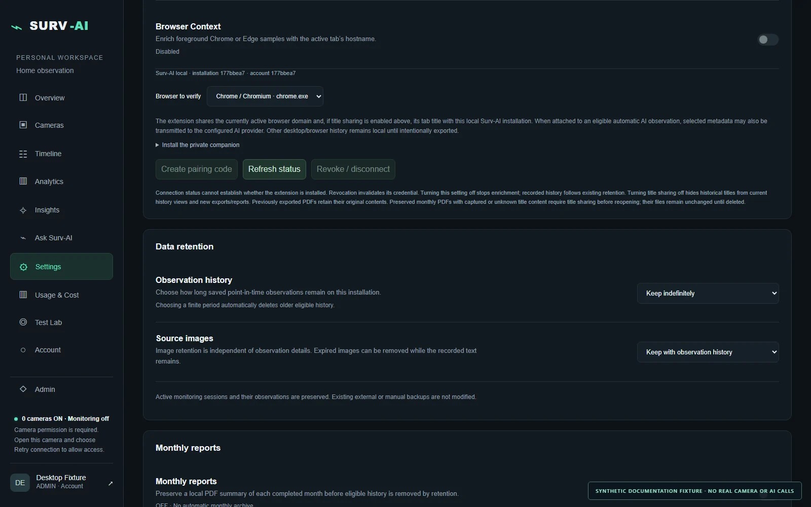 |
| **Monthly reports** | **Usage & Cost** |
| 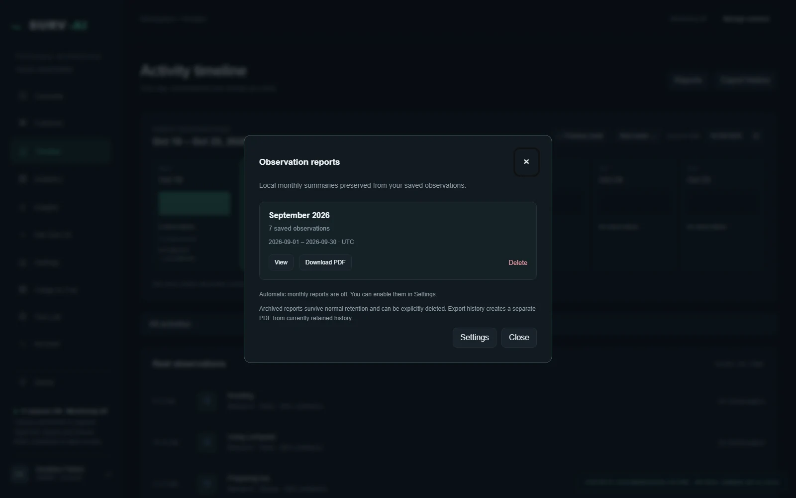 | 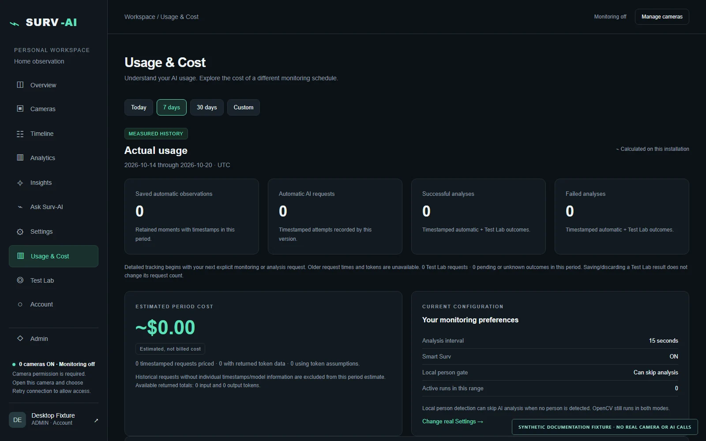 |

[Settings and retention controls →](docs/screenshots/14-settings.webp)

## What is implemented

| Capability | What the current application does |
| --- | --- |
| **Multiple local cameras** | Saved device mappings, per-camera controls and 0°/90°/180°/270° orientation; simultaneous capture depends on browser and USB hardware. |
| **Local person detection** | CPU OpenCV + MobileNet-SSD checks, configurable 0.20–0.75 threshold, validity/freshness states and fail-closed detector errors. |
| **AI snapshot interpretation** | Explicit Test Lab analysis or eligible automatic snapshots use image input and a strict structured result contract. |
| **Smart Surv** | Default-ON person gating reduces eligible image requests; turning it off permits valid scheduled frames without a positive detection. |
| **Camera Areas and rotation** | One Area interval and saved round-robin order; optional Detection-Only Rotation limits the Area to fresh positive cameras. |
| **Monitoring lifecycle** | 15/30/60-second intervals, one shared analysis lock, no catch-up bursts, and the same camera/session runtime across internal navigation. |
| **Persistent history** | Owned SQLite observations, sessions and optional snapshots; date/camera/activity filters and retained source details. |
| **Desktop Context** | Optional Windows foreground application and active/idle/locked/unavailable samples; window titles require separate consent. |
| **Browser Context** | Optional unpacked Chrome/Edge companion with explicit pairing; exact hostname and optionally tab title, without page bodies or browsing-history access. |
| **Independent context monitoring** | Camera-free Start/Pause/Resume/Stop; saved opt-in can reconnect at login/refresh, while manual Pause/Stop is respected during the visit. |
| **Analytics Explorer** | Date ranges, daily/hourly charts, recorded distributions and context drilldowns; counts describe recorded evidence. |
| **Ask Surv-AI** | Deterministic local day/week queries over retained records with source evidence; no conversational LLM or general-purpose chatbot. |
| **Usage & Cost** | Measured request metadata when available, incomplete-history indicators, and a separate hypothetical estimator. Estimates are not invoices. |
| **Reports** | On-demand 7/30-day PDFs and optional completed-calendar-month archives, generated locally from retained history. |
| **Data controls** | Owned export, password-confirmed history reset/account deletion, independent image retention and protected active sessions. |
| **Accounts** | Local email/password, Argon2id, session/CSRF protections, ADMIN account management and server-enforced user ownership. |
| **Windows background startup** | Optional hidden Scheduler launcher, duplicate protection, logs and authenticated graceful Stop/Restart. |

Desktop/browser integration and simultaneous multi-camera use should be treated as **experimental across hardware/browser combinations**. Their protocol, ownership and lifecycle have automated synthetic tests; physical device, sleep/resume and prolonged-use acceptance remain separate. There is no RTSP camera ingestion, cloud sync, wearable integration, email recovery or Google sign-in.

## How it works

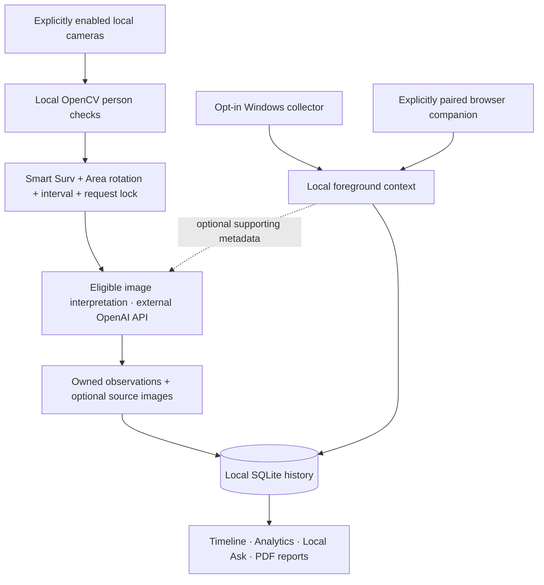

The Node HTTP server binds to **127.0.0.1**. The browser owns camera permission and capture; the application-level monitoring controller survives route changes. A bounded Python worker handles person checks. Server tickets bind an eligible check to its frame, and one provider lock prevents overlapping analysis. Optional Windows/browser context has its own consent and lifecycle. Persistent records feed deterministic local views and reports. [Architecture and engineering details →](docs/ARCHITECTURE.md)

## Technology stack

| Technology | Role |
| --- | --- |
| Node.js 24.7+ | HTTP server, native SQLite, native Argon2id, authentication, scheduling policy and data ownership |
| JavaScript, HTML and CSS | Browser UI, camera capture, shared monitoring controller, charts and public synthetic demos |
| SQLite | Transactional local accounts, settings, observations, sessions and context metadata |
| Python, OpenCV, NumPy, MobileNet-SSD | Local CPU person detection; downloaded model files are checksum verified |
| OpenAI Responses API | Optional image interpretation with structured output; no client-side API credential |
| Python / ReportLab | Local deterministic PDF generation |
| Manifest V3 extension | Explicitly paired Chrome/Edge active-tab metadata |
| PowerShell / Windows APIs / .NET | Foreground collector, hidden process supervisor and optional Task Scheduler integration |
| Node test runner / Playwright | Regression fixtures and isolated browser/documentation acceptance |

There are **no npm runtime dependencies or frontend build steps**. Python dependencies are optional by feature. No Docker image or hosted production service is supplied.

## Install on Windows

1. Download the release ZIP and extract it to a writable folder. Alternatively, clone **this repository**, whose root contains `package.json`, `server.mjs`, `src/` and `dist/`.

2. Install the required dependencies:

   - **[Node.js 24.7 or later](https://nodejs.org/en/download)** — required to run Surv-AI.
   - **[Python](https://www.python.org/downloads/windows/)** — optional, but required for local person detection and PDF generation. Python 3.13 is recommended.

   If using the Python Install Manager, install Python 3.13 with:

   ```powershell
   py install 3.13
   ```

   Verify the installation:

   ```powershell
   node --version
   py -3.13 --version
   ```

   **Note:** Installing the Python Install Manager does not necessarily install a Python runtime. Close and reopen PowerShell after installing dependencies.

3. Open PowerShell in the extracted application folder and run:

   ```powershell
   powershell.exe -NoProfile -ExecutionPolicy Bypass -File .\setup.ps1
   npm.cmd start
   ```

   **PowerShell compatibility:** Use `npm.cmd start` rather than `npm start` to avoid the `npm.ps1 cannot be loaded because running scripts is disabled` error on Windows. No system-wide execution-policy changes are required.

4. Open **[http://localhost:4173/](http://localhost:4173/)**.

   Choose **Get started**, create your local owner account and follow the onboarding process.

   During onboarding, you can configure your own OpenAI API key directly through the application. API configuration can also be deferred.

   **Note:** AI observations require a configured API key and may incur API usage charges. Local camera preview and person detection do not require OpenAI API credits.

   Stay on the same hostname (`localhost` or `127.0.0.1`) to preserve your browser session.

5. Stop the foreground server with **Ctrl+C**.

   Starting Surv-AI does not automatically enable cameras, context collection, AI monitoring, monthly archives or Windows automatic startup.

### Optional: Local Person Detection and PDF Reports

Surv-AI supports local OpenCV-based person detection and PDF reporting through optional Python dependencies.

To install both, run:

```powershell
# Downloads Python packages and checksum-verified detector models.
powershell.exe -NoProfile -ExecutionPolicy Bypass -File .\setup.ps1 -LocalDetection -Reports
```

Alternatively, install only the local person detection dependencies:

```powershell
powershell.exe -NoProfile -ExecutionPolicy Bypass -File .\setup-local.ps1
```

The setup script installs optional Python packages into this installation's `.local-python` directory rather than bundling a personal Python environment.

After installation, restart Surv-AI:

```powershell
npm.cmd start
```

Local person detection processes camera frames on your computer without using OpenAI API credits. AI interpretation is separate and requires an API key.

**Auto Monitoring is opt-in.** Enabling a camera does not automatically enable AI monitoring.

**API configuration:** create your own API project/key following the [official OpenAI quickstart](https://developers.openai.com/api/docs/quickstart). Save it through the private onboarding form, or edit `.env` created from [.env.example](.env.example). Never put it in `dist/`, browser storage or Git. The stored key is a local server configuration file, **not an encrypted credential vault**; protect the installation folder. Environment configuration takes precedence. API access and billing are separate from installing Surv-AI.

The preserved default is `gpt-4.1-mini`. Its [official model page](https://developers.openai.com/api/docs/models/gpt-4.1-mini) currently marks the model family deprecated. Confirm access/availability before enabling AI; `OPENAI_MODEL` is configurable. Paid provider compatibility was not revalidated for this release, and changing models may require compatibility testing.

See the [complete installation and troubleshooting guide](docs/INSTALLATION.md), [browser companion setup](browser-companion/README.md) and [optional Windows background startup](docs/WINDOWS-STARTUP.md). Installing or running the application does **not** register a startup task.

## Privacy and security

- Accounts, observations, camera mappings, context, snapshots and reports stay in your installation's private runtime directories until deliberately exported.
- Only explicitly submitted or eligible Auto-ON image analysis calls the external API. Opted-in supporting context may accompany it. The project is not fully offline.
- Fresh installs start empty. Cameras need browser permission and user action; Auto Monitoring starts OFF. Previously saved enabled previews can restore when permission permits. Independent context's saved opt-in has its separately documented reconnect behavior.
- Desktop collection, title sharing and Browser Context are opt-in. The companion excludes incognito and sends hostname rather than paths, query strings or page content.
- History defaults to indefinite retention; source images follow history; monthly reports default OFF. Review settings before collecting sensitive material. Export/delete controls do not erase external/manual backups or provider-held copies.
- Use the application only with informed consent. Do not expose the plain loopback HTTP server on the internet. This is a local application, not an independently audited multi-tenant hosting product.

[Privacy details](docs/PRIVACY.md) · [Public distribution security audit](docs/SECURITY-AUDIT.md) · [Reporting a security issue](SECURITY.md)

## Cost

Local collection, person checks, local Ask, analytics and PDF rendering use your computer's resources. Optional image interpretation uses **your API account** and can incur usage charges. Shorter intervals, more cameras and Smart Surv OFF can increase eligible requests. Pause monitoring, choose a longer interval or omit API configuration to avoid accidental use. There is no guaranteed free tier or savings claim.

Usage & Cost clearly separates retained measured history from hypothetical projections. Pricing assumptions can become stale and historical token data can be incomplete; your provider's billing records are authoritative. Review [OpenAI spend controls](https://developers.openai.com/api/docs/guides/spend-limits) before sustained monitoring.

## Limitations

Windows is the documented target for foreground collection and the hidden launcher. Core browsing may run elsewhere, but this release does not certify macOS/Linux. Camera quality, lighting, CPU load, USB bandwidth and browser suspension affect capture/detection. AI and person detection can be wrong; confidence is not a calibrated guarantee. Missing observations do not establish absence, and observed objects do not establish use. Session spans are not activity duration. Browser pairing is unpacked/developer-mode, not a store release. Real hardware, a second physical computer, abrupt power loss and paid API access were not tested for this distribution.

## Development and engineering

The project brings together multi-camera orchestration, local computer vision, cost-aware API gating, transactional history, owned account data and Windows process supervision. The difficult parts are lifecycle boundaries: keeping one monitoring runtime across navigation, spacing Area requests fairly, preserving active history during retention, invalidating private sessions correctly and shutting down pending work before SQLite closes.

```powershell
npm test
python tools/verify_public.py
python tools/package_release.py
```

Tests use disposable data and mocked providers. The packager extends the existing source-only workflow with an explicit [public file allowlist](public-files.json), privacy/link validation, deterministic ZIP entries and per-file hashes. Generated files are ignored. [Development guide](CONTRIBUTING.md) · [Verification](docs/RELEASE-VERIFICATION.md)

## Roadmap

Future work is separate from the current feature set: broader hardware/OS validation, longitudinal evidence-aware insights, user-defined goals, richer contextual recall, optional wearable integrations and professional review reports with explicit evidence limits. No medical or workplace performance claim is made. [Roadmap →](docs/ROADMAP.md)

## License and contributing

**No project license has been selected or approved.** No `LICENSE` file is included, and package metadata is `UNLICENSED`. This is not yet an open-source license grant. Resolve the project's distribution/contribution terms before presenting it as open source. Third-party dependencies keep their own terms; model weights and runtimes are not bundled. See [license status and dependencies](docs/THIRD-PARTY.md) and [contribution guidance](CONTRIBUTING.md).
